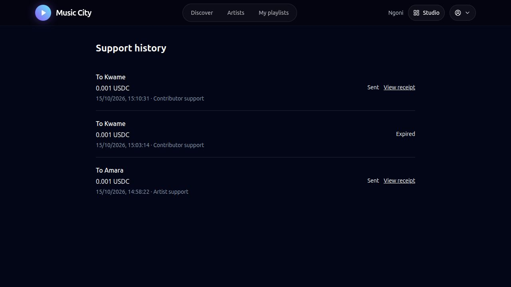
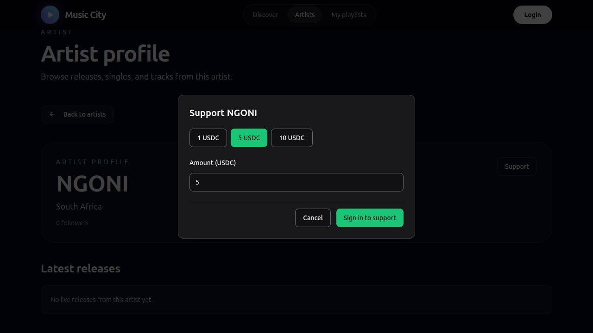

# Direct fan support verification

Implemented 15 October 2026 from `a00d98d`. The canonical checklist is [SUP-01 through SUP-12](../sow-2-tracker.md#direct-fan-support-implementation-chunk). This chunk covers direct support in D2-06, D2-07, and the related D3 integration. Reviewer acceptance remains separate.

## User flow

1. Open an artist profile or a public song. Select **Support** beside the artist or a registered contributor.
2. Choose a USDC amount. Review the recipient, wallet, and exact amount.
3. Select **Sign and send**. The connected Dynamic Stellar wallet authorizes that exact transaction.
4. Confirmation appears automatically. **Account > Support history** shows sent and received payments with explorer receipts.

A listener contributor can receive support without artist activation. The server resolves destinations from public profiles, linked recording credits, or a verified finalized agreement. A fan cannot type an arbitrary destination or support their own wallet.

## Lifecycle and recovery

The API prepares one direct Stellar USDC operation, with a unique memo, original hash, sequence, and five-minute time bound. It checks the network, trustlines, authorization, recipient capacity, spendable USDC, XLM reserve, and fee before review.

`POST /support/:id/authorize` verifies the exact body and source-account signature threshold. It commits the signed envelope before submission. `POST /support/:id/submit` submits that retained envelope. The financial worker reconciles pending payments and retries the same hash at most five times, at least 15 seconds apart. A timeout remains pending. It never creates a replacement payment while the outcome is unresolved.

Expiry requires a closed ledger beyond the transaction time bound, no matching receipt, and retained Horizon history covering preparation. Pruned or unavailable history leaves the payment unresolved. Cancelling an unsigned prepared payment does not submit it. The worker still checks cancelled transactions until their time bound passes.

Migration `2026-10-15-direct-support` creates retained payment records, unique sender request keys, one active payment per sender, and append-only events. Database triggers protect original terms, signatures, and confirmed outcomes. Support does not use the treasury or change royalty splits, purchases, subscriptions, or protected 2-of-3 operations.

The user history is `/account/support`. Administrators have a read-only `/console/support` view. Public recipient reads are unauthenticated; payment history and mutations require a session. Only the sender can authorize, submit, or cancel. Individual payment reads are restricted to its sender and recipient.

## Real browser and Testnet results

[Independent transaction and balance evidence](testnet.json) records actual Horizon receipts, exact transaction bodies, browser wallet signatures, database events, received history, and final balances. Dynamic Sandbox Google authentication supplied both payment signatures. No fan private key was supplied to the CLI. Disposable Testnet funds were used.

| Destination | Amount | Confirmed receipt |
| --- | --- | --- |
| Artist Amara | 0.001 USDC | [Artist payment](https://stellar.expert/explorer/testnet/tx/564e96041b61f166496014fd188b70d9371b9fc0e502e2a11e90f3a98dd497f8) |
| Contributor Kwame | 0.001 USDC | [Contributor payment](https://stellar.expert/explorer/testnet/tx/4fba178c9ba2f838fff5752925e9bdcb146795bebb9f63eba222974d911c1fcd) |

The fan received 0.01 test USDC, sent 0.002, and retained 0.008. Each recipient gained exactly 0.001. The two payment fees total 0.00002 XLM. Each confirmed payment was submitted once.

A separate contributor signing attempt was cancelled in Dynamic. It retained zero signatures and zero submissions. It expired during recovery checks. A new request was allowed only after verified expiry and receipt absence. This is not evidence of a successful same-hash browser retry; automated tests cover that behavior.

The browser also verified user history and the administrator's prepared, authorized, submit-attempt, and confirmed events. The local disposable database contains separate mocked-transport integration fixtures. Those fixture receipts are not real chain evidence. Only the two hashes above establish actual support transfers.

## Automated checks

- Server suite: 119 passed, nine opt-in suites skipped.
- Support PostgreSQL suite: 11 passed separately against disposable PostgreSQL, with real signatures and mocked chain transport.
- Client suite: 96 passed across 25 files.
- Admin suite: 16 passed across four files.
- Workspace typecheck and all production builds passed.

The support tests cover exact amounts, changed transactions, wrong networks, signature thresholds, invalid recipients, unauthorized reads and writes, readiness, concurrent preparation, repeated requests, durable authorization, uncertain submissions, original-hash recovery, immutable records and events, cancellation, chain-based expiry, pruned history, and failed receipts.

Run normal checks with `pnpm test`, `pnpm typecheck`, and `pnpm build`. Run the support PostgreSQL test against an isolated initialized database by setting `SUPPORT_TEST_DATABASE_URL` and executing the server support integration test. Never use the production database for that suite.

## Deployment

[Deployment verification](deployment.json) records implementation commit `2dbca88a718f0b8d0f8e77c69f3a2f11bbad5d8c`. The API, media worker, and financial worker are successful on Railway. Both Vercel frontends are ready. The support migration, immutable triggers, required indexes, API readiness, route authentication, CORS, served bundles, and financial-worker startup passed verification. The live browser also opened the artist Support dialog.

A private PostgreSQL backup preceded rollout. Before-and-after hashes match for the existing users, recordings, releases, royalty records, agreements, and settlement batches. Production contains zero support payment fixtures or demonstration events. Live Dynamic authentication retains its existing environment; the served bundle contains no Sandbox environment. Sandbox authentication is used only for the local browser demonstration.

The local disposable demonstration remains available for testing. Its artist and contributor records are distinct from production. Financial receipts and history are retained.

